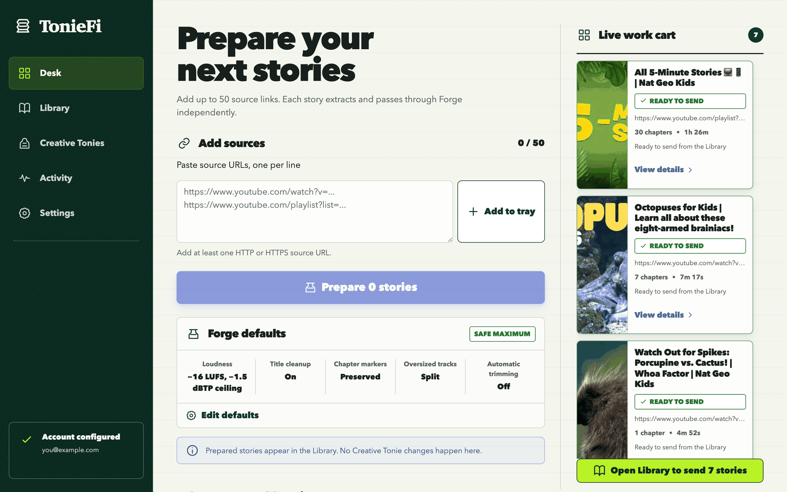
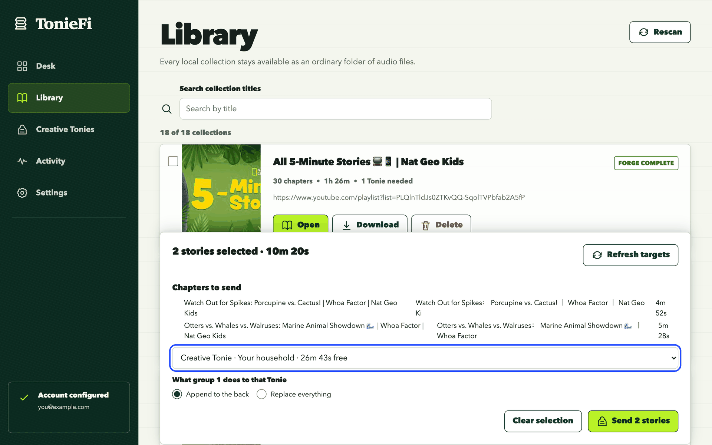

# TonieFi

TonieFi helps you put your own stories on a Creative Tonie. You paste a few links, it cleans up
the audio, and you choose what goes on which Tonie.

It runs on your own computer, and your stories stay there as normal MP3 files.



## What you need

- A Creative Tonie.
- A myTonies account that does not use two-factor login (a second code sent when you sign in).
- A computer that can run Docker (macOS, Windows or Linux). Docker is a free tool that runs apps
  in a sealed box, so you do not install anything else.

## Install

**1. Get Docker.**

| Your machine | What to install |
|---|---|
| macOS | [Docker Desktop](https://www.docker.com/products/docker-desktop/). Pick the Apple silicon or Intel build to match your Mac |
| Windows | [Docker Desktop](https://www.docker.com/products/docker-desktop/). The installer turns on WSL2 for you |
| Linux | Docker Engine: `curl -fsSL https://get.docker.com \| sh`, then `sudo usermod -aG docker $USER` and log back in |

On macOS and Windows, open Docker Desktop once and leave it running. Then check it works:

```bash
docker --version
```

**2. Make a folder and download the setup file.** Run these in a terminal (the text window where
you type commands):

```bash
mkdir toniefi && cd toniefi
curl -O https://raw.githubusercontent.com/loubylabs/Toniefi/main/docker-compose.yml
```

**Linux only:** run these two lines before the first start. Without them, the files TonieFi makes
belong to the admin user, and you cannot delete them easily. Skip them on macOS and Windows.

```bash
mkdir -p library data work
printf 'TONIEFI_UID=%s\nTONIEFI_GID=%s\n' "$(id -u)" "$(id -g)" >> .env
```

**3. Start it.**

```bash
docker compose up -d
```

Then open <http://127.0.0.1:8080> in your browser.

Your stories are saved in the `library` folder inside `toniefi`. Settings and job history are in
`data`.

## First use

1. Open **Settings**. Enter your myTonies email and password. Press **Save local credentials**,
   then **Test connection**.
2. Open the **Desk**. Paste one or more links, one per line. Press **Add to tray**, then
   **Prepare stories**. TonieFi downloads and cleans up each one.
3. Open the **Library**. Tick a story and choose a Creative Tonie. Press the **Send** button. It
   reads "Send 3 chapters", or however many you picked. Nothing goes to a Tonie until you press
   it.
4. Put the Tonie on your Toniebox. It downloads the new audio when it syncs.



You can also paste podcast links and search LibriVox (free public-domain audiobooks). The
[user guide](docs/operations/user-guide.md) covers both. **Creative Tonies** lets you tidy what is
already on a Tonie. **Activity** shows every job and lets you retry one that failed.

## Day to day

Run these in the folder that holds `docker-compose.yml`.

| Command | What it does |
|---|---|
| `docker compose up -d` | Starts TonieFi in the background |
| `docker compose ps` | Shows whether it is running |
| `docker compose logs -f` | Shows what it is doing. `Ctrl-C` stops watching, not the app |
| `docker compose restart` | Restarts it |
| `docker compose down` | Stops it. Your stories stay |
| `docker compose pull && docker compose up -d` | Takes an update |

If a link stops working, take an update. An old copy is the most common cause.

## Before you rely on it

- **Unofficial.** TonieFi uses a private tonies service and is not affiliated with tonies or
  Boxine. It can break without notice. Your local stories stay safe, and the official myTonies app
  still works.
- **No undo.** **Replace everything** and clearing a Tonie delete its current audio for good.
- **Plain-text password.** **Settings** saves your password as plain text on your computer. Keep
  the `data` folder private.
- **No login, no HTTPS.** Do not open TonieFi to the internet. For remote use, try Tailscale (a
  private network app).
- **Your own audio only.** Use audio you may copy. TonieFi does not bypass copy protection.

## More help

| Document | What is in it |
|---|---|
| [User guide](docs/operations/user-guide.md) | Every feature, step by step |
| [Configuration](docs/operations/configuration.md) | Settings, the `.env` file, Unraid |
| [Troubleshooting](docs/operations/troubleshooting.md) | Links that will not load, common failures |
| [Development](docs/operations/development.md#run-without-docker) | Run without Docker, run the tests |
| [Architecture](docs/architecture/overview.md) | How the pieces fit together |
| [HTTP API](docs/architecture/api.md) | Endpoints and `curl` examples |

## License

MIT
