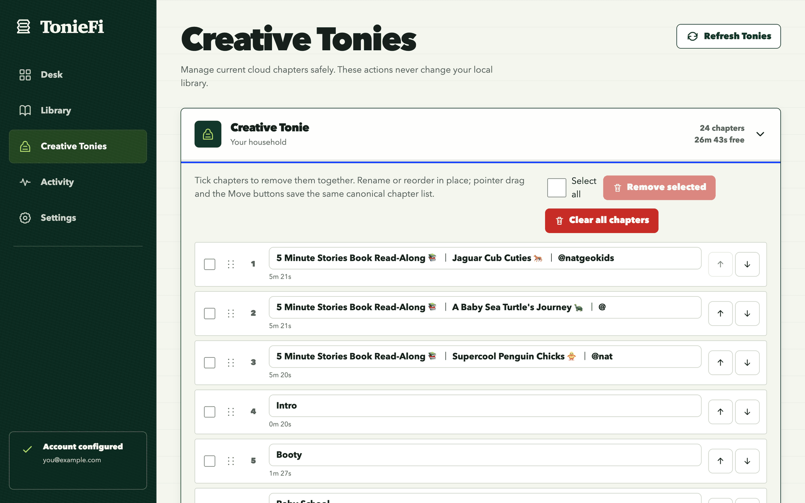

# Using TonieFi

How to add stories, clean them up, choose what goes on which Creative Tonie, and send it.

```text
Paste sources  ->  automatic cleanup  ->  Library  ->  confirmed send
```

Nothing reaches a Creative Tonie until you pick it, name a target, and press **Send**.

## Add stories on the Desk


Paste up to 50 links, one per line, and press **Add to tray**. Each link becomes a row you can
check over. **Prepare stories** starts them. Each link is its own job, so one dead link never
blocks the rest of the batch. You can also search LibriVox or upload your own files.

### Podcasts

Paste a Spotify show or episode link, an Apple Podcasts link, or the show's RSS feed. Press
**Pick episodes** and tick the stories you want. Episodes are listed oldest first. The audio comes
from the publisher's own feed, so only shows with a public feed work. Spotify-only shows cannot be
imported.

### Remove ads

Podcast hosts stitch ads into each download. A podcast collection's page has a **Remove ads**
button. It downloads every episode again and cuts whatever the new copy does not have. The ads
change from one download to the next. An ad that is in both copies stays until a later run. Send
the story to your Tonie again afterward.

### Pick videos

A link with `list=` in it is a playlist. It gets a **Pick videos** control. The control lists the
playlist without downloading anything, and you untick the videos you do not want. Only the ticked
videos are downloaded, so removing a video costs nothing. If you untick every video, TonieFi holds
the row back with an inline error instead of submitting it.

### The work cart

The work cart below the Desk shows each job as it runs. A row that is ready, has been sent, or has
failed has a **Dismiss** control that clears it out of the way. Dismissing only hides the row. It
never deletes anything. The job is still in Activity, and a finished story is still in the Library.
Only the newest finished send stays in the cart. Older sends are in Activity.

## How Forge cleans the audio

Every source is downloaded and then run through **Forge**. Forge is the automatic cleanup pass.

| Pass | What it does |
|---|---|
| Chapters | Keeps the source's own chapter markers |
| Level | Normalises loudness to −16 LUFS with a −1.5 dBTP ceiling |
| Titles | Strips noise such as `FULL AUDIOBOOK`, `[HD]` and channel-name prefixes |
| Split | Cuts any track too long to fit one Tonie into even parts |
| Trim | Off by default. Set it if your source has an intro to cut |

LUFS is a loudness measure. dBTP is the loudest peak the audio may reach, so the sound never
distorts.

### Forge defaults

Your **Forge defaults** save themselves. Change them once. The same settings then prefill the next
URL, LibriVox and upload preparation on this machine, for every browser that opens TonieFi. They
are starting values, not a rule. Each batch stays editable. One import can keep the source's
chapter markers while the next one ignores them.

## Choose and send from the Library


The Library lists every local collection. Open one to check its cover, chapter titles, order and
playback. You can also reorder and rename chapters. **Download** gives you the whole collection as
one zip.

If a playlist held a video the site refused to serve, the rest still arrive. The row says how many
videos were left out. The tracks that did arrive are numbered without gaps, so nothing else would
tell you a video was missing.

### Pick what to send

Sending starts here. Tick the collections you want. A selection bar appears. It packs them into
capacity groups, and each group is one Tonie's worth of audio. The bar shows exactly which
chapters land in which group. Every group needs its own Creative Tonie before **Send** unlocks.
Two groups cannot name the same Tonie.

### Choose chapters

You may not want to send a story whole. A story has a **Choose chapters** control. It opens the
story's chapter list with a tick box on each chapter. A long import can go to one Creative Tonie
now and the rest another day.

- **All** ticks every chapter.
- **None** unticks every chapter.
- **Add a Tonie's worth** ticks forward from the last ticked chapter until the next one would not
  fit. Nobody has to count minutes.

The story's own tick box still means every chapter. It shows a dash while only some chapters are
chosen.

### Append or replace

**Append to the back** is the default. It sends straight away, because you can remove the added
chapters afterwards. **Replace everything** always asks first and names every affected Tonie. It
destroys that Tonie's current cloud audio, and there is no undo.

### Live send progress

A send reports itself while it happens. The selection bar becomes a live receipt with a real
percentage. The work cart shows the same send. The Creative Tonie being written to says so on its
own row. If a send stops part way, it tells you what already landed.

## Tidy a Creative Tonie



The Creative Tonies screen reads the live cloud list before every change. From here you can:

- Rename a chapter.
- Reorder chapters by drag, or with the Move buttons.
- Tick several chapters and remove them in one save.
- Clear the Tonie completely.
- Rename the Tonie itself.

Each Tonie shows its own figure. Renaming helps when two Tonies were both called
"Creative-Tonie". Removing and clearing both ask for confirmation. The dialog names the figure it
is about to change.

If the myTonies app or another tab changed the same Tonie first, TonieFi refuses the stale write.
It reloads the real list instead of overwriting someone else's edit. These actions only touch the
Tonie Cloud. Your local library is never changed from this screen.

## Work keeps running

Jobs are stored in a SQLite database (a small file-based database), so they carry on when you
close the browser. **Activity** keeps the 40 most recent jobs with their progress, errors and retry
buttons. You can retry a failed preparation without losing the original error.

**Settings** holds your myTonies credentials and a connection test. It also names the version you
are running and the commit its image was built from. Quote both when you report a problem.

## Your files stay yours

```text
library/peter-pan/collection.json
library/peter-pan/cover.jpg
library/peter-pan/001-chapter-i.mp3
library/peter-pan/002-chapter-ii.mp3
```

`collection.json` holds the track order, titles and durations. Files you drop in by hand show up
after a Library rescan. If you delete TonieFi, the folders and MP3 files still work in any other
player.

## Signing in with environment variables

You can sign in through Settings, or put your myTonies login in the `.env` file beside
`docker-compose.yml`. Every setting in that file is optional. To see the full commented list:

```bash
curl -o .env https://raw.githubusercontent.com/loubylabs/Toniefi/main/.env.example
```

Uncomment only the lines you actually want. In particular, leave `TONIES_USERNAME` and
`TONIES_PASSWORD` commented out unless you are setting real ones. Filling them in makes the
environment the credential source, and that disables the Settings form. A placeholder there locks
you out of the other way to sign in.

[Configuration](configuration.md) lists every variable, and how to run TonieFi on Unraid.
